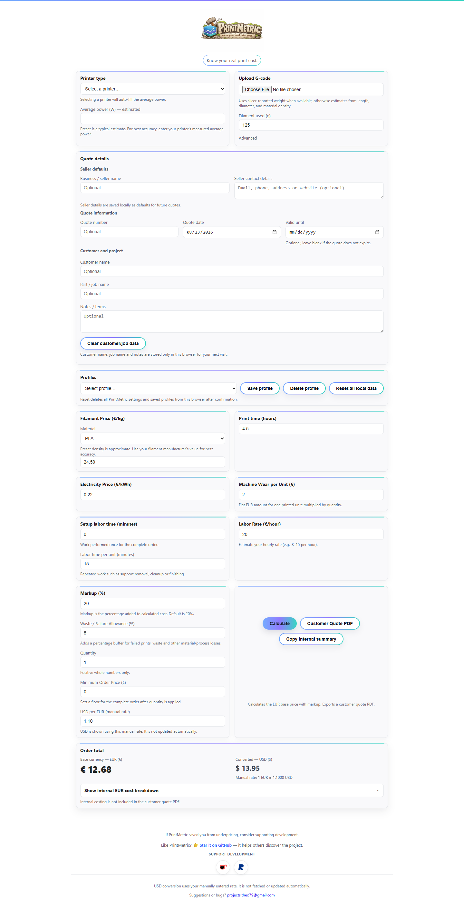

# PrintMetric

### Know your real print cost.
<div align="center">

# PrintMetric ⚡
**Know your real 3D print cost. Local-first, private, and zero dependencies.**

[]()
[]()
[](LICENSE)
[](https://github.com/theo79/printmetric)

[Live Demo](https://theo79.github.io/printmetric/) · [Report Bug](https://github.com/theo79/printmetric/issues) · [Request Feature](https://github.com/theo79/printmetric/issues)

</div>

---

### Why PrintMetric?

Most 3D printing calculators only look at filament weight. **PrintMetric** accounts for the full economics of additive manufacturing:
- ⚡ **True Energy Consumption:** Computes electricity based on printer wattage and exact print duration.
- 📉 **Machine Depreciation:** Accounts for bed/nozzle wear, maintenance, and hardware amortization.
- ⏱️ **Hands-on Labor:** Splits one-time pre-flight/slicing setup from per-unit post-processing.
- 📦 **Automated Slicer Import:** Drag & drop `.gcode` or `.3mf` files (Bambu Studio, PrusaSlicer, OrcaSlicer, Cura) for instant parameter extraction.
- 📄 **Client-Ready Quotes:** Live sticky pricing sidebar with one-click branded PDF quotation export.
- 🔒 **100% Private & Local:** Runs completely inside your browser using Vanilla JS. No servers, no tracking, no logins.

PrintMetric is a lightweight, browser-based tool for calculating the real cost of a 3D print.

It helps makers, hobbyists, and small print shops move beyond simple filament-cost estimates by including the other costs that are easy to overlook.

**No login. No subscription. No tracking. Just transparent 3D printing cost calculation.**

---

## Try PrintMetric Online

**https://theo79.github.io/printmetric/**

No installation required — it runs directly in your browser.

---

## What PrintMetric Calculates

PrintMetric calculates all monetary inputs and prices in EUR. It can calculate your print cost using:

* Filament usage
* Filament price in EUR per kg
* Print time
* Electricity price in EUR per kWh
* Printer power consumption
* Machine wear as a flat EUR amount per printed unit
* Setup labor performed once per order
* Labor repeated for each unit
* Markup
* Waste / failure allowance
* Quantity
* Minimum order price in EUR

The internal cost breakdown makes it easy to see where your money is actually going before deciding what to charge.

---

## Printer Presets

Select your printer and PrintMetric automatically fills an estimated average power consumption.

The printer database includes popular models from manufacturers such as:

* Bambu Lab
* Prusa
* Creality
* Elegoo
* Anycubic
* Artillery

The estimated wattage is always editable.

If you have measured the real average consumption of your printer, simply replace the preset value for more accurate calculations.

You can also select **Other** and enter the power consumption manually.

---

## Material Presets

PrintMetric includes density presets for common 3D printing materials:

* PLA
* PETG
* ABS
* ASA
* TPU
* Nylon (PA)
* PC
* Custom materials

Selecting a material automatically fills its approximate density.

The density remains editable, so you can use the exact value provided by your filament manufacturer when available.

Your actual filament price per kg is always entered manually — because real spool prices vary.

---

## Supported G-code and slicers

Upload a G-code file and PrintMetric can automatically detect:

* Print time
* Filament usage
* Filament weight when available

When the slicer reports filament weight directly, PrintMetric uses that value. When the G-code provides only filament length, PrintMetric estimates weight using the currently selected filament diameter and material density. Changing either value recalculates a length-derived estimate; it does not replace a weight reported directly by the slicer.

#### Large G-code files

G-code imports use bounded `Blob.slice()` reads instead of loading every large file into memory. PrintMetric first inspects 256 KiB from the beginning and 512 KiB from the end, where slicers commonly store metadata. If required metadata is still incomplete, files up to 16 MiB may receive a full fallback scan. Larger files receive a bounded expanded scan of at most 1 MiB from the beginning and 2 MiB from the end and are never fully loaded.

Files over 2 GiB are rejected before reading as a browser-safety safeguard. These byte limits are configurable in `GCODE.parseFile()` for testing or future tuning. If supported metadata is absent from a large file's sampled sections, the UI explains that manual values are required.

Compatible with metadata produced by common slicers.

Manual inputs remain available when metadata is missing or when you want to override an estimate.

---

## Pricing formula reference

PrintMetric keeps the calculation explicit and retains full precision until values are displayed:

```text
filament cost per unit = filament grams / 1000 × filament price per kg
electricity cost per unit = average watts / 1000 × print hours × electricity price per kWh
machine wear per unit = entered flat machine-wear amount
setup labor cost = labor rate per hour × setup minutes / 60
labor cost per unit = labor rate per hour × per-unit labor minutes / 60

order production subtotal =
  (filament cost per unit + electricity cost per unit + machine wear per unit
   + labor cost per unit) × quantity
  + setup labor cost

waste allowance = order production subtotal × waste allowance percentage / 100
markup amount = adjusted production cost × markup percentage / 100
minimum order price = floor applied to the calculated complete-order total
effective unit price = displayed complete-order total / quantity
converted USD total = displayed EUR total × manually entered USD-per-EUR rate
```

### Supported filament metadata

PrintMetric currently recognizes these comment patterns:

* **Cura:** `Filament used: 1.2m` and multi-extruder lists such as `Filament used: 1.2m, 0.35m`; optional `Filament weight = [3.6, 1.1]` values are interpreted as grams.
* **PrusaSlicer / SuperSlicer:** `filament used [mm]`, `filament used [m]`, `filament used [g]`, and their `total filament used [...]` forms.
* **OrcaSlicer:** comma-separated `filament used [mm]` and `filament used [g]` lists, plus explicit total fields.
* **Bambu Studio:** `total filament length [mm]` and `total filament weight [g]` fields using either `:` or `=`.
* **Generic metadata:** filament or material length values when every value includes an explicit `mm` or `m` unit.

For multi-extruder lists, all valid values are retained and summed for the current single-material cost calculation. If both length and reliable weight metadata are present, slicer-reported weight is used for costing and length is retained only as metadata. Explicit total fields replace rather than add to per-extruder lists, preventing double-counting.

---

## Waste / Failure Allowance

Failed prints cost more than just filament.

PrintMetric includes an optional **Waste / Failure Allowance (%)** as a practical contingency for:

* Failed prints
* Purging and test prints
* Scraps and supports
* Minor material or process losses
* Other uncertainty
* Electricity
* Machine use
* Labor

The default allowance for new users is **5%**. It is calculated as a simple percentage buffer:

```text
allowance = base production cost × (allowance percentage / 100)
adjusted cost = base production cost + allowance
```

All monetary amounts in this formula are EUR.

The allowance is treated as part of the real production cost before markup is calculated. It is not a statistical failure-probability model. Non-negative values are accepted without an arbitrary maximum.

Set it to **0%** if you don't want to include an allowance.

---

## Quantity and Labor

Filament, print energy, electricity, and machine wear are treated as per-unit production costs and multiplied by quantity. This preserves the existing meaning of print time and wear cost as values for one printed item.

Labor uses one shared hourly rate with two time inputs:

* **Setup labor time** is charged once for the complete order.
* **Labor time per unit** is multiplied by quantity.

```text
order production subtotal =
  (per-unit filament + electricity + wear + per-unit labor) × quantity
  + setup labor
```

All monetary terms in this formula are EUR. Machine wear is the entered flat EUR amount per unit; it is not an hourly rate.

Quantity must be entered as a positive whole number.

---

## Minimum Order Price

The optional **Minimum Order Price** is a floor for the complete order, not for each unit. PrintMetric calculates the quantity-adjusted production and labor costs, adds setup labor once, applies the allowance and markup, and then compares that calculated order total with the minimum order price.

For example, if 10 units produce a calculated order total of €30 and the minimum order price is €50, the final order total is €50. The customer quote shows a unit equivalent of €5.

Set the minimum order price to **0** to disable it.

---

## Cost & Pricing Breakdown

PrintMetric provides an internal EUR cost breakdown including:

* Filament cost for the order
* Energy and electricity for the order
* Setup labor charged once
* Per-unit labor across the order
* Total labor cost
* Machine wear for the order
* Production subtotal for the order
* Waste / failure allowance
* Adjusted production cost
* Markup amount
* Effective price per unit
* Quantity
* Grand total

This breakdown is intended for **you**, not your customer.

---

## Customer Quote PDF

PrintMetric can generate a clean, customer-facing quote directly from the browser.

The customer quote can include:

* Customer name
* Job / part name
* Material
* Printer
* Quantity
* Estimated print time
* Unit price in EUR
* Total price in EUR
* An indicative converted USD value using your manual EUR → USD rate
* Notes

Your internal business information stays private.

The customer PDF does **not** expose:

* Filament cost
* Electricity cost
* Labor cost
* Machine wear
* Waste / failure allowance
* Production subtotal
* Markup percentage
* Markup amount

Your customer sees the quote — not how you calculated your markup.

---

## Profiles & Local Storage

PrintMetric is local-first. The following values are stored in your browser's `localStorage` so they can be restored on the next visit:

* **Customer/job information:** customer name (`printmetric_customerName`), part/job name (`printmetric_jobName`), and notes (`printmetric_quoteNotes`).
* **Current pricing values:** filament price, electricity price, machine wear per unit, setup labor time, labor time per unit, labor rate, markup, waste/failure allowance, quantity, and minimum order price.
* **Current print/material values:** printer, average power, material, filament diameter, material density, filament weight, and print time.
* **Manual exchange rate:** USD per EUR (`printmetric_usdPerEur`).
* **Named profiles:** all saved profiles are stored together under `printmetric_profiles`.

The current-value keys use the `printmetric_` prefix followed by their existing field IDs. In addition to the three customer/job keys and exchange-rate key listed above, these are:

```text
printmetric_filamentCostPerKg
printmetric_electricityCost
printmetric_machineWearCost
printmetric_setupLaborMins
printmetric_handsOnLaborMins
printmetric_laborCostPerHour
printmetric_profitMargin
printmetric_failureWasteAllowance
printmetric_quantity
printmetric_minimumPrice
printmetric_avgPower
printmetric_materialType
printmetric_filamentDiameter
printmetric_filamentDensity
printmetric_filamentUsedGrams
printmetric_printTimeHours
printmetric_printerType
```

Each named profile stores reusable filament pricing, electricity, machine wear, setup and per-unit labor, labor rate, markup, waste allowance, printer/power selection, material/density, minimum order price, and quantity. A custom printer profile can also store `otherPowerW`. Profiles do **not** contain customer names, job names, notes, the manual exchange rate, filament weight, print time, or filament diameter.

The **Clear customer/job data** button removes only the customer name, job name, and notes. It does not delete pricing settings or profiles. **Reset all local data** removes all keys owned by PrintMetric, including named profiles, and requires confirmation.

This data is not sent to a PrintMetric server. PrintMetric has no backend, analytics, or tracking, and its calculations remain local to the browser. External support and repository links are opened only when you choose them.

Existing saved `handsOnLaborMins` values are treated as labor time per unit, matching the previous calculation where that labor was multiplied by quantity. Setup labor is a new field and defaults to zero.

### Numeric input validation

PrintMetric validates numeric fields inline and does not silently replace malformed or negative values with zero. Filament weight and quantity are required; quantity must be a positive whole number. Filament diameter, material density, and the manual EUR-to-USD rate must be greater than zero. Cost, time, power, labor, markup, allowance, and minimum-order inputs accept zero where zero has a meaningful interpretation, but do not accept negative values.

Decimal values such as `12.5`, small values such as `0.01`, and zero-valued optional costs are supported. No arbitrary upper limits are imposed. In particular, the former 100% cap on waste allowance has been removed; unusually large non-negative allowances remain an explicit user choice.

No account or cloud storage is required.

---

## 💱 EUR / USD

PrintMetric uses EUR as the base calculation currency for every monetary input, formula, minimum price, and quote total. USD is output-only: it is calculated from the final EUR amount using the manually entered EUR → USD rate.

The EUR → USD rate is entered manually and stored locally in the browser. PrintMetric does not fetch, refresh, or automatically update exchange rates, so the entered rate remains predictable until you change it. EUR pricing and USD conversion remain fully functional offline.

---

## Why PrintMetric Exists

A 3D print doesn't cost only the price of the filament.

Real printing costs can also include electricity, printer wear, hands-on work, failed prints, wasted material, and the time your machine is occupied.

Ignoring those costs can easily lead to underpricing.

**PrintMetric makes those costs visible.**



Know the cost. Set your markup. Price your work properly.

---

## Privacy

PrintMetric is designed to stay simple.

* No account
* No login
* No subscription
* No tracking
* No backend required

Calculations and saved settings stay in your browser.

---

## Tech Stack

* Vanilla HTML
* CSS
* JavaScript
* Browser Local Storage
* No framework
* No backend

PrintMetric is hosted using GitHub Pages.

---

## ⭐ Like PrintMetric?

If PrintMetric helped you price your prints more accurately, consider **starring the repository**.

A GitHub star helps other makers discover the project and supports its continued development.

**https://github.com/theo79/printmetric**

---

## Feedback & Contributions

Suggestions, bug reports, printer data corrections, and improvement ideas are welcome.

If you find an issue, feel free to open an issue on GitHub.

---

## Author

Built by **Theocharis Anastopoulos**.

Engineer. Maker. Tool builder.

---

**PrintMetric — Know your real print cost.**
